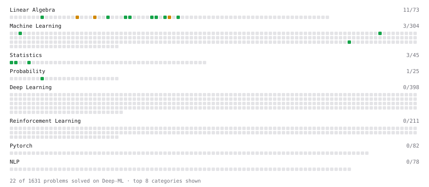

# Deep-ML

My machine learning practice from [Deep-ML](https://www.deep-ml.com). Every solution here was written by hand.

**84** solved · 31 problems · 0 labs · 53 math

[**Browse the interactive portfolio**](https://SerinaTraore.github.io/deep-ml/) to replay this filling in over time.

## Problems

| | Difficulty | Solved | |
| --- | --- | --- | --- |
| [Calculate 2x2 Matrix Inverse](https://www.deep-ml.com/problems/8) | easy | 2026-10-01 | [solution](problems/0008-calculate-2x2-matrix-inverse) |
| [Calculate Conditional Probability from Data](https://www.deep-ml.com/problems/168) | easy | 2026-10-21 | [solution](problems/0168-calculate-conditional-probability-from-data) |
| [Calculate Cosine Similarity Between Vectors](https://www.deep-ml.com/problems/76) | easy | 2026-10-07 | [solution](problems/0076-calculate-cosine-similarity-between-vectors) |
| [Calculate Covariance Matrix](https://www.deep-ml.com/problems/10) | easy | 2026-10-01 | [solution](problems/0010-calculate-covariance-matrix) |
| [Check Linear Independence of Vectors](https://www.deep-ml.com/problems/331) | easy | 2026-10-01 | [solution](problems/0331-check-linear-independence-of-vectors) |
| [Compute Posterior Probability using Bayes' Theorem](https://www.deep-ml.com/problems/336) | easy | 2026-10-21 | [solution](problems/0336-compute-posterior-probability-using-bayes-theorem) |
| [Demonstrate Law of Large Numbers with Sampling](https://www.deep-ml.com/problems/342) | easy | 2026-10-21 | [solution](problems/0342-demonstrate-law-of-large-numbers-with-sampling) |
| [Derivative of a Polynomial](https://www.deep-ml.com/problems/116) | easy | 2026-10-07 | [solution](problems/0116-derivative-of-a-polynomial) |
| [Derivatives of Activation Functions](https://www.deep-ml.com/problems/217) | easy | 2026-10-21 | [solution](problems/0217-derivatives-of-activation-functions) |
| [Descriptive Statistics Calculator](https://www.deep-ml.com/problems/78) | easy | 2026-10-07 | [solution](problems/0078-descriptive-statistics-calculator) |
| [Dot Product Calculator](https://www.deep-ml.com/problems/83) | easy | 2026-10-07 | [solution](problems/0083-dot-product-calculator) |
| [Empirical Probability Mass Function (PMF)](https://www.deep-ml.com/problems/184) | easy | 2026-10-07 | [solution](problems/0184-empirical-probability-mass-function-pmf) |
| [Expected Value and Variance of an n-Sided Die](https://www.deep-ml.com/problems/179) | easy | 2026-10-07 | [solution](problems/0179-expected-value-and-variance-of-an-n-sided-die) |
| [Feature Scaling Implementation](https://www.deep-ml.com/problems/16) | easy | 2026-09-29 | [solution](problems/0016-feature-scaling-implementation) |
| [Gradient Direction and Magnitude](https://www.deep-ml.com/problems/308) | easy | 2026-10-07 | [solution](problems/0308-gradient-direction-and-magnitude) |
| [Implement Orthogonal Projection of a Vector onto a Line](https://www.deep-ml.com/problems/66) | easy | 2026-10-01 | [solution](problems/0066-implement-orthogonal-projection-of-a-vector-onto-a-line) |
| [Matrix Determinant & Trace](https://www.deep-ml.com/problems/195) | easy | 2026-10-01 | [solution](problems/0195-matrix-determinant-trace) |
| [Random Train/Validation/Test Split with Shuffling](https://www.deep-ml.com/problems/1058) | easy | 2026-09-29 | [solution](problems/1058-random-train-validation-test-split-with-shuffling) |
| [Vector Element-wise Sum](https://www.deep-ml.com/problems/121) | easy | 2026-10-07 | [solution](problems/0121-vector-element-wise-sum) |
| [Vector Norms (L1/L2/L-inf) and the Frobenius Norm](https://www.deep-ml.com/problems/328) | easy | 2026-10-07 | [solution](problems/0328-vector-norms-l1-l2-l-inf-and-the-frobenius-norm) |
| [Calculate Correlation Matrix](https://www.deep-ml.com/problems/37) | medium | 2026-10-01 | [solution](problems/0037-calculate-correlation-matrix) |
| [Chain Rule for Composite Functions](https://www.deep-ml.com/problems/214) | medium | 2026-10-21 | [solution](problems/0214-chain-rule-for-composite-functions) |
| [Conditional Probability from Joint Distribution](https://www.deep-ml.com/problems/180) | medium | 2026-10-21 | [solution](problems/0180-conditional-probability-from-joint-distribution) |
| [Derivative of Cross-Entropy Loss w.r.t. Logits](https://www.deep-ml.com/problems/220) | medium | 2026-10-21 | [solution](problems/0220-derivative-of-cross-entropy-loss-w-r-t-logits) |
| [Derivative of Softmax](https://www.deep-ml.com/problems/219) | medium | 2026-10-21 | [solution](problems/0219-derivative-of-softmax) |
| [Gaussian Elimination for Solving Linear Systems](https://www.deep-ml.com/problems/58) | medium | 2026-10-01 | [solution](problems/0058-gaussian-elimination-for-solving-linear-systems) |
| [Jacobian Matrix Calculation](https://www.deep-ml.com/problems/202) | medium | 2026-10-21 | [solution](problems/0202-jacobian-matrix-calculation) |
| [Matrix Rank](https://www.deep-ml.com/problems/329) | medium | 2026-10-01 | [solution](problems/0329-matrix-rank) |
| [Numerical Gradient Checking](https://www.deep-ml.com/problems/313) | medium | 2026-10-21 | [solution](problems/0313-numerical-gradient-checking) |
| [Partial Derivatives of Multivariable Functions](https://www.deep-ml.com/problems/215) | medium | 2026-10-21 | [solution](problems/0215-partial-derivatives-of-multivariable-functions) |
| [Quotient Rule for Derivatives](https://www.deep-ml.com/problems/312) | medium | 2026-10-07 | [solution](problems/0312-quotient-rule-for-derivatives) |

## Math

| | Difficulty | Solved | |
| --- | --- | --- | --- |
| [Bootstrap Resampling: $(1-1/n)^n$ and Out-of-Bag Points](https://www.deep-ml.com/math-problems/82) | easy | 2026-10-13 | [solution](math/0082-bootstrap-resampling-1-1-n-n-and-out-of-bag-points) |
| [Matrix Basics](https://www.deep-ml.com/math-problems/9) | easy | 2026-10-02 | [solution](math/0009-matrix-basics) |
| [Model Selection: CV, AIC, and BIC](https://www.deep-ml.com/math-problems/43) | easy | 2026-10-02 | [solution](math/0043-model-selection-cv-aic-and-bic) |
| [Probability Fundamentals](https://www.deep-ml.com/math-problems/19) | easy | 2026-10-07 | [solution](math/0019-probability-fundamentals) |
| [Vector Operations](https://www.deep-ml.com/math-problems/7) | easy | 2026-10-02 | [solution](math/0007-vector-operations) |
| [Backpropagation and the Chain Rule](https://www.deep-ml.com/math-problems/4) | medium | 2026-10-01 | [solution](math/0004-backpropagation-and-the-chain-rule) |
| [Bayes' Theorem](https://www.deep-ml.com/math-problems/20) | medium | 2026-10-01 | [solution](math/0020-bayes-theorem) |
| [Bias–Variance Decomposition](https://www.deep-ml.com/math-problems/39) | medium | 2026-10-02 | [solution](math/0039-bias-variance-decomposition) |
| [Chi-Square Tests: Goodness of Fit and Independence](https://www.deep-ml.com/math-problems/87) | medium | 2026-10-13 | [solution](math/0087-chi-square-tests-goodness-of-fit-and-independence) |
| [Coefficient Standard Errors, t-Statistics, and p-Values](https://www.deep-ml.com/math-problems/75) | medium | 2026-10-13 | [solution](math/0075-coefficient-standard-errors-t-statistics-and-p-values) |
| [Common Distributions I: Bernoulli, Binomial, Uniform](https://www.deep-ml.com/math-problems/21) | medium | 2026-10-01 | [solution](math/0021-common-distributions-i-bernoulli-binomial-uniform) |
| [Common Distributions II: Normal, Poisson, Exponential](https://www.deep-ml.com/math-problems/22) | medium | 2026-10-01 | [solution](math/0022-common-distributions-ii-normal-poisson-exponential) |
| [Confidence Intervals vs Prediction Intervals](https://www.deep-ml.com/math-problems/77) | medium | 2026-10-13 | [solution](math/0077-confidence-intervals-vs-prediction-intervals) |
| [Covariance and Correlation](https://www.deep-ml.com/math-problems/17) | medium | 2026-09-30 | [solution](math/0017-covariance-and-correlation) |
| [Credible Intervals vs Confidence Intervals](https://www.deep-ml.com/math-problems/89) | medium | 2026-10-13 | [solution](math/0089-credible-intervals-vs-confidence-intervals) |
| [Determinants and Trace](https://www.deep-ml.com/math-problems/11) | medium | 2026-09-30 | [solution](math/0011-determinants-and-trace) |
| [Expected Waiting Time for Coin Patterns: First-Step Analysis](https://www.deep-ml.com/math-problems/242) | medium | 2026-10-13 | [solution](math/0242-expected-waiting-time-for-coin-patterns-first-step-analysis) |
| [Family-Wise Error Rate: Bonferroni and Holm](https://www.deep-ml.com/math-problems/84) | medium | 2026-10-13 | [solution](math/0084-family-wise-error-rate-bonferroni-and-holm) |
| [Information Theory: Entropy](https://www.deep-ml.com/math-problems/24) | medium | 2026-10-02 | [solution](math/0024-information-theory-entropy) |
| [Inverse and Rank](https://www.deep-ml.com/math-problems/12) | medium | 2026-09-30 | [solution](math/0012-inverse-and-rank) |
| [Law of Large Numbers and Central Limit Theorem](https://www.deep-ml.com/math-problems/23) | medium | 2026-10-01 | [solution](math/0023-law-of-large-numbers-and-central-limit-theorem) |
| [Least Squares as Maximum Likelihood under Gaussian Noise](https://www.deep-ml.com/math-problems/156) | medium | 2026-10-10 | [solution](math/0156-least-squares-as-maximum-likelihood-under-gaussian-noise) |
| [Leverage, Outliers, and Cook's Distance](https://www.deep-ml.com/math-problems/78) | medium | 2026-10-13 | [solution](math/0078-leverage-outliers-and-cook-s-distance) |
| [Log-Likelihood Gradients](https://www.deep-ml.com/math-problems/38) | medium | 2026-10-02 | [solution](math/0038-log-likelihood-gradients) |
| [Logistic Regression as Maximum Likelihood](https://www.deep-ml.com/math-problems/40) | medium | 2026-09-30 | [solution](math/0040-logistic-regression-as-maximum-likelihood) |
| [LOOCV vs $k$-Fold: the Bias-Variance of $k$](https://www.deep-ml.com/math-problems/80) | medium | 2026-10-19 | [solution](math/0080-loocv-vs-k-fold-the-bias-variance-of-k) |
| [Matrix Calculus Identities](https://www.deep-ml.com/math-problems/35) | medium | 2026-09-30 | [solution](math/0035-matrix-calculus-identities) |
| [Matrix Multiplication](https://www.deep-ml.com/math-problems/10) | medium | 2026-10-02 | [solution](math/0010-matrix-multiplication) |
| [Multicollinearity and the Variance Inflation Factor](https://www.deep-ml.com/math-problems/79) | medium | 2026-10-13 | [solution](math/0079-multicollinearity-and-the-variance-inflation-factor) |
| [Multivariate Calculus](https://www.deep-ml.com/math-problems/2) | medium | 2026-09-30 | [solution](math/0002-multivariate-calculus) |
| [Multivariate Gaussians](https://www.deep-ml.com/math-problems/36) | medium | 2026-10-01 | [solution](math/0036-multivariate-gaussians) |
| [Neural Network Derivatives](https://www.deep-ml.com/math-problems/3) | medium | 2026-10-01 | [solution](math/0003-neural-network-derivatives) |
| [Optimization: Convexity and Critical Points](https://www.deep-ml.com/math-problems/6) | medium | 2026-10-02 | [solution](math/0006-optimization-convexity-and-critical-points) |
| [Orthogonality and Projections](https://www.deep-ml.com/math-problems/14) | medium | 2026-09-30 | [solution](math/0014-orthogonality-and-projections) |
| [PCA via Covariance Eigendecomposition](https://www.deep-ml.com/math-problems/49) | medium | 2026-10-02 | [solution](math/0049-pca-via-covariance-eigendecomposition) |
| [Positive Definite Matrices and Quadratic Forms](https://www.deep-ml.com/math-problems/50) | medium | 2026-10-02 | [solution](math/0050-positive-definite-matrices-and-quadratic-forms) |
| [Regularization and Generalization](https://www.deep-ml.com/math-problems/31) | medium | 2026-10-02 | [solution](math/0031-regularization-and-generalization) |
| [RSE, $R^2$, and the F-Statistic for Overall Significance](https://www.deep-ml.com/math-problems/76) | medium | 2026-10-13 | [solution](math/0076-rse-r-2-and-the-f-statistic-for-overall-significance) |
| [Softmax and Cross-Entropy](https://www.deep-ml.com/math-problems/32) | medium | 2026-10-01 | [solution](math/0032-softmax-and-cross-entropy) |
| [Solving Linear Systems](https://www.deep-ml.com/math-problems/13) | medium | 2026-09-30 | [solution](math/0013-solving-linear-systems) |
| [Statistical Inference](https://www.deep-ml.com/math-problems/27) | medium | 2026-10-10 | [solution](math/0027-statistical-inference) |
| [Taylor Expansions and Local Quadratic Models](https://www.deep-ml.com/math-problems/37) | medium | 2026-10-01 | [solution](math/0037-taylor-expansions-and-local-quadratic-models) |
| [The Bootstrap: a Standard Error Without a Formula](https://www.deep-ml.com/math-problems/81) | medium | 2026-10-19 | [solution](math/0081-the-bootstrap-a-standard-error-without-a-formula) |
| [The Challenge of Multiple Testing](https://www.deep-ml.com/math-problems/123) | medium | 2026-10-13 | [solution](math/0123-the-challenge-of-multiple-testing) |
| [Two-Sample Tests: Pooled t, Welch, and Paired](https://www.deep-ml.com/math-problems/86) | medium | 2026-10-13 | [solution](math/0086-two-sample-tests-pooled-t-welch-and-paired) |
| [Type I and Type II Error, Power, and the Uniform Null](https://www.deep-ml.com/math-problems/83) | medium | 2026-10-13 | [solution](math/0083-type-i-and-type-ii-error-power-and-the-uniform-null) |
| [Vector Norms and Linear Independence](https://www.deep-ml.com/math-problems/8) | medium | 2026-10-02 | [solution](math/0008-vector-norms-and-linear-independence) |
| [Bayesian Methods](https://www.deep-ml.com/math-problems/28) | hard | 2026-10-19 | [solution](math/0028-bayesian-methods) |
| [Eigendecomposition and SVD](https://www.deep-ml.com/math-problems/16) | hard | 2026-10-02 | [solution](math/0016-eigendecomposition-and-svd) |
| [KL Divergence](https://www.deep-ml.com/math-problems/25) | hard | 2026-10-02 | [solution](math/0025-kl-divergence) |
| [Matrix Decompositions: LU and QR](https://www.deep-ml.com/math-problems/15) | hard | 2026-10-02 | [solution](math/0015-matrix-decompositions-lu-and-qr) |
| [Maximum Likelihood and MAP](https://www.deep-ml.com/math-problems/26) | hard | 2026-10-02 | [solution](math/0026-maximum-likelihood-and-map) |
| [Moment-Generating Functions and a Central Limit Theorem Sketch](https://www.deep-ml.com/math-problems/148) | hard | 2026-10-19 | [solution](math/0148-moment-generating-functions-and-a-central-limit-theorem-sketch) |

---

_This file is regenerated by Deep-ML on every push._
